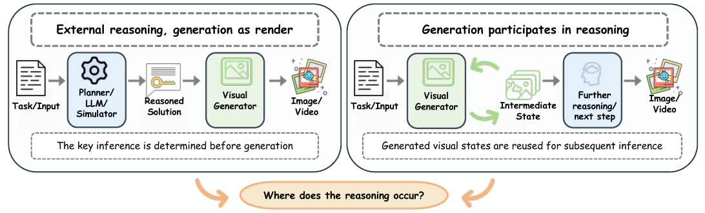
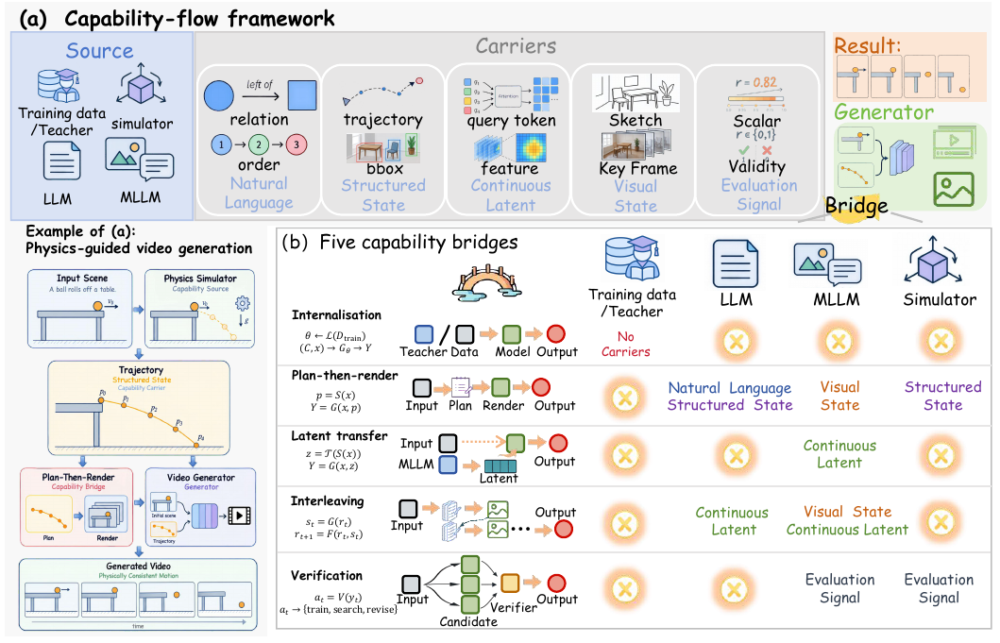
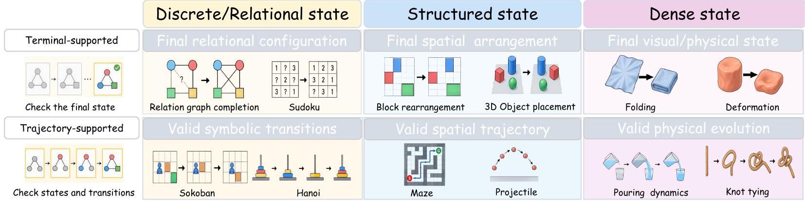
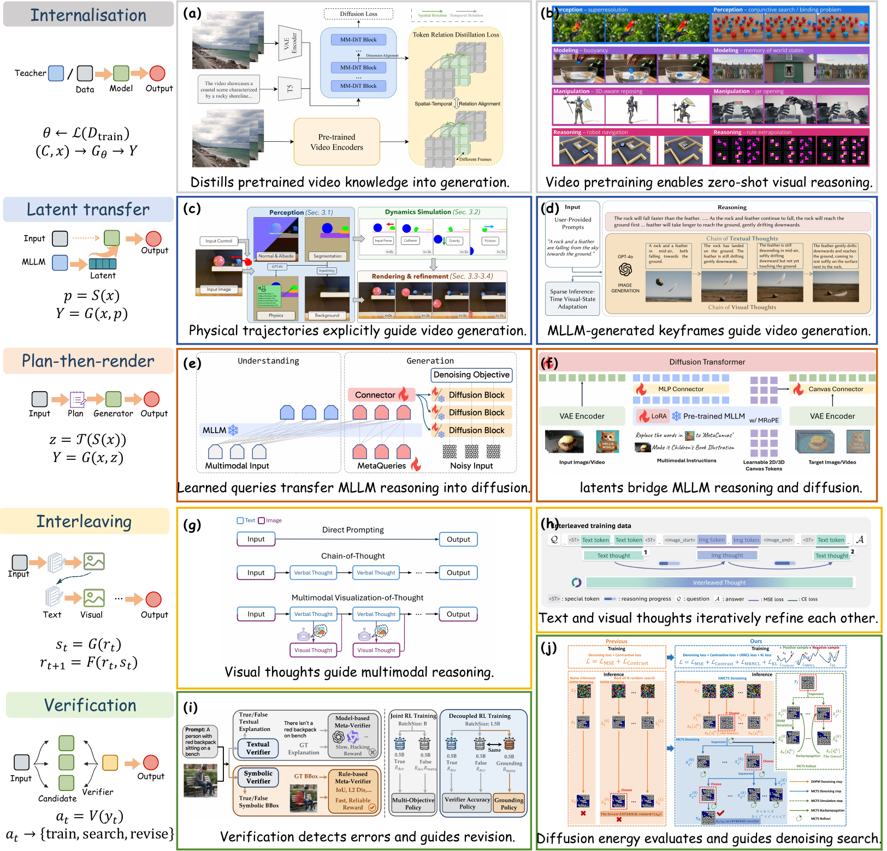

# A Survey of Generative Visual Reasoning

生成式视觉推理综述

**Dylan Yan** · sole first author, with MMLab, NTU  
独立一作，合作于南洋理工大学 MMLab

Manuscript under review. This repository shares the survey’s main argument and figures. The manuscript PDF is not released here.

稿件在投。本仓库公开综述的主要内容和图片，不发布论文 PDF。

Project page: <https://anzy200299-ui.github.io/generative-visual-reasoning-survey/>  
Personal site: <https://anzy200299-ui.github.io/>

## Definition

Generative Visual Reasoning (GVR) refers to visual generation tasks whose correctness depends on inferring task-relevant states, relations, or transitions that are not explicitly given in the input. The inferred information must be represented consistently in the generated output. The definition does not assume that the visual generator itself performs the inference.

生成式视觉推理（GVR）指：输出要正确，就必须推断输入中没有明确给出的任务相关状态、关系或转移，并且这些信息要一致地体现在生成结果中。该定义不假设推断一定由视觉生成器完成。

## Where reasoning occurs

A correct generated video does not identify where the inference happened. An external planner or simulator may determine the solution before generation. Alternatively, generated intermediate visual states can be reused for subsequent reasoning.

生成结果正确，并不能说明推理发生在哪里。外部规划器或仿真器可以在生成前确定解；生成的中间视觉状态也可以被后续推理继续使用。

## Framework

A method is described by three parts:

- **Capability source:** training data, a language model, a multimodal model, a simulator or formal system, or a pretrained teacher.
- **Capability carrier:** natural language, a structured state, a continuous latent, a visual state, or an evaluation signal.
- **Capability bridge:** internalisation, plan-then-render, latent transfer, interleaving, or verification.

能力来源说明信息从哪里来，能力载体说明信息以什么形式传递，能力桥接说明信息如何影响生成器。

## Task taxonomy

Tasks vary by the task-relevant state—discrete or relational, structured, or dense—and by the temporal scope of correctness. Terminal-supported tasks depend on the final state. Trajectory-supported tasks also require valid intermediate states and transitions.

任务按状态类型和时间范围划分。终态任务看最终状态；轨迹任务还要求中间状态和转移有效。

| Scope | Discrete / relational | Structured | Dense |
| --- | --- | --- | --- |
| Terminal-supported | Relation-graph completion, Sudoku | Block rearrangement, 3D placement | Folding, deformation |
| Trajectory-supported | Sokoban, Hanoi | Maze navigation, projectile motion | Pouring, knot tying |

## Capability bridges

- **Internalisation** learns the capability in the generator.
- **Plan-then-render** produces an explicit plan before generation.
- **Latent transfer** injects externally inferred information through learned features.
- **Interleaving** reuses generated visual states in later reasoning.
- **Verification** uses correctness feedback for training, search, or revision.

These mechanisms can be combined. Example images in the figure are adapted from the cited works.

五种机制可以组合。图中的示例改编自相应论文。

## Key messages

1. Match the output to what correctness requires: a final state, the intermediate states, or dense video when sparse states omit essential motion or interactions.
2. Choose the capability bridge according to the information a task needs and how that information can be supplied. Bridges can be combined.
3. Task success does not locate the inference. Attribution needs controlled interventions on sources, carriers, and bridges.
4. Generated visual states are useful reasoning intermediates when later decisions depend on information they preserve. Compare them with explicit plans and compact representations under the same task conditions.

输出形式要匹配正确性要求。桥接方式要匹配任务所需信息，也可以组合。任务成功不能定位推理发生处。生成视觉状态是否有用，要看后续决策是否依赖它所保留的信息。

## Evaluation

Check the state and temporal scope required by the task, not visual quality alone. Terminal tasks need a correct final state. Trajectory tasks also need valid transitions. Continuous physical interactions need finer temporal evidence, and one reference trajectory is not the only valid outcome.

评估应针对任务要求的状态和时间范围。终态任务检查最终状态；轨迹任务还要检查转移。连续物理交互需要更细的时间证据，一条参考轨迹也不是唯一合法结果。

VBVR and VBVR-Pro show the value of fully verifiable evaluation: rule-based scorers make video-reasoning results reproducible, interpretable, and usable as task-grounded feedback. Verifiability remains relative to the stated constraints and the reliability of extracting states from generated pixels. A verified result establishes task success, not which component reasoned.

VBVR 与 VBVR-Pro 说明，基于规则的可验证评估有助于复现、诊断，并提供与任务对应的反馈。可验证性仍然相对于明确的约束，以及从生成像素中提取状态的可靠性。验证通过只说明任务成功，不能说明是哪个组件完成了推理。

## Availability

Co-author names are withheld during anonymous review. This page will be updated when the full author list and citation record can be released.

匿名审稿期间暂不列出合作者。完整作者名单和引用信息会在可以公开时补充。
